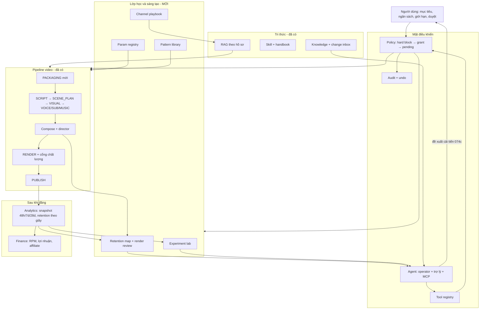

# Kiến trúc đích (khoảng 12 tháng)

> Viết ngày 2026-11-11. Đi cùng `docs/ROADMAP.md`. Đầu vào: `BLUEPRINT.md`, `IDEAS.md` (bản 2), `ARCHITECTURE.md` v0.2, bảng task, `CON-THIEU.md`, TASK-059 §1, TASK-073 §1 và §6–§10, TASK-074, TASK-070, và một lượt đọc `db/schema.ts`, `registry/`, `assistant/tools.ts`, `schemas/autonomy.ts`.
> Nguyên tắc: chúng ta xây tool, dữ liệu, cách đo, rào chắn. Agent (operator + trợ lý) vận hành và tự học. Agent không sửa code, không đụng tiền, không tự nâng quyền, không tự duyệt đề xuất của mình.
> Ràng buộc giữ nguyên: một người dùng, một máy Windows, SQLite + Drizzle, worker trong tiến trình, không microservice, không Redis, không ORM thứ hai.
> Tên bảng, tool, grant mới trong tài liệu này là **đề xuất**, chưa có trong code. Guide của từng task chốt tên cuối.

## 1. Sơ đồ tổng

**Vòng của agent** (mỗi bước là tool, không phải code chạy ngầm thay agent):

| Bước | Agent làm gì | Công cụ | Ghi vào |
|---|---|---|---|
| Quan sát | Đọc số liệu, bản đồ giữ chân, tự xem bản dựng, change inbox, radar | `get_retention_map`, `review_render`, `list_change_events`, analytics | `render_reviews` |
| Đặt giả thuyết | Chọn một biến, chỉ số chính, cỡ mẫu, điều kiện dừng | `create_experiment` | `experiments` |
| Thử | Code gán video vào nhánh, áp tham số/mẫu của nhánh cho đúng video đó | pipeline đọc `param_values`, `creative_patterns` | `experiment_assignments`, `video_genes` |
| Kết luận | Đọc chênh lệch và độ chắc do code tính, quyết giữ/bỏ/chạy thêm | `get_experiment_result`, `conclude_experiment` | `experiments.conclusion` |
| Học | Đổi mặc định, ghi bài học, cho mẫu nghỉ hoặc lên mặc định | `set_param`, `add_playbook_entry`, `propose_pattern` | `param_values`, `channel_playbook_entries` |
| Đề xuất cải tiến | Khi thiếu tool hoặc dữ liệu | `file_improvement_request` (074c) | `docs/proposals/` sau khi người duyệt |

## 2. Các khối và ranh giới

Bảy khái niệm dễ lẫn. Quy tắc phân biệt: **hỏi nó trả lời câu gì**.

| Khối | Trả lời câu | Dạng | Phạm vi | Ai ghi | Ai duyệt | Hết hạn |
|---|---|---|---|---|---|---|
| **Knowledge** (073a, có) | "Thế giới bên ngoài đang thế nào?" (chính sách, API, RPM, luật) | Dữ liệu có nguồn, quote, ngày kiểm | App, thị trường, nền tảng | Agent đề xuất qua research, người, import | `low` có quote tự áp dụng, còn lại người | Có (volatility) |
| **Skill** (063/074b) | "Làm việc X theo các bước nào?" | Markdown `SKILL.md`, có phiên bản | App | Agent soạn nháp, repo | Người kích hoạt (skill `read` có thể tự bật) | Rollback theo outcome |
| **Channel playbook** (mới) | "Khán giả của kênh này phản ứng thế nào?" | Dữ liệu: phát biểu + bằng chứng nội bộ | Hồ sơ (+ format, thị trường) | Agent, người | Mặc định người. Xem giả định ở §5 | Có, phải kiểm lại |
| **Param registry** (mới) | "Núm này đang vặn ở đâu?" | Định nghĩa + giới hạn là **code**. Giá trị là dữ liệu | App → hồ sơ → format | Agent (trong giới hạn), người | Theo grant | Không. Có lịch sử, hoàn tác |
| **Pattern library** (mới) | "Có những kiểu hook/tiêu đề/format/cung nhạc/bố cục nào?" | Dữ liệu theo schema Zod. Template và renderer là **code** | App hoặc hồ sơ | Agent đề xuất, người, bản dựng sẵn | Mẫu mới phải qua lab trước khi thành mặc định | Mẫu thua bị cho nghỉ |
| **Experiment lab** (mới) | "Thay đổi này có thật sự tốt hơn?" | Code (gán nhóm, snapshot, thống kê, bandit gợi ý) + dữ liệu | Hồ sơ | Agent, người | Trong trần thử nghiệm | Kết luận xong thì đóng |
| **Retention map / render review** (mới) | "Video này mất người xem ở đâu, bản dựng trông thế nào?" | Code tính, tính lúc đọc. Lời phê là dữ liệu | Video | Code. Lời phê do agent | Không cần | Theo lần fetch |

Ranh giới quan trọng:
- Bài học **nội bộ** (từ số của kênh) vào playbook. Dữ kiện **bên ngoài** vào knowledge. `format_signal` của 073d là knowledge vì trộn cả tín hiệu ngoài, và lab là nơi cập nhật nó.
- Playbook nói "nên làm gì". Param là nơi điều đó thành con số máy đọc. Một kết luận thường sinh cả hai: một mục playbook và một lần `set_param`, cùng trỏ về `experimentId`.
- Pattern là "cái gì có thể chọn". Param là "chọn bao nhiêu, ngưỡng nào". Skill là "agent tự làm việc thế nào". Không cái nào chứa logic chạy được.
- `operator/playbooks.ts` hiện là playbook **tự sửa lỗi** của supervisor. Khối mới đặt tên `channel playbook` (thư mục `playbook/`) và nên đổi tên file cũ thành `selfHeal.ts` để hết lẫn.
- `profile_memories` giữ góp ý và sở thích của người dùng. `profile_insights` (bản tin tuần của 035) thành nguồn đề xuất mục playbook, không thay playbook.

## 3. Data model (mức thực thể)

Bảng hiện có giữ nguyên trừ khi ghi "mở rộng". Cột JSON vẫn được kiểm bằng Zod trong `packages/shared`.

| Bảng | Mới / mở rộng | Khoá và quan hệ chính | Ghi chú |
|---|---|---|---|
| `param_values` | mới | `id`; (`key`, `scopeType`, `scopeId`); `experimentId?`, `prevValueId?` | Chỉ thêm dòng. Giá trị hiệu lực là dòng mới nhất chưa `revertedAt`. Có `setBy`, `reason`, `evidenceRef` |
| `param_user_bounds` | mới | (`key`, `scopeType`, `scopeId`) | Người dùng siết giới hạn. Chỉ phiên chủ ghi được |
| định nghĩa tham số | code | `packages/shared/src/params/defs.ts`: key, kiểu, mặc định, min, max, bước tối đa, phạm vi cho phép, nơi dùng | Test: mọi key có nơi dùng, mọi nơi dùng đọc qua resolver |
| `experiments` | mới | `id`, `profileId` → `profiles` | hypothesis, variableKind (`param`/`pattern`/`gene`), variableKey, arms, primaryMetric, minSamplePerArm, stopRule, status, conclusion, createdBy |
| `experiment_assignments` | mới | (`experimentId`, `projectId`) duy nhất; duy nhất (`projectId`, `variableKey`) | Một video không nằm trong hai thử nghiệm cùng biến |
| `experiment_results` | mới | (`experimentId`, `arm`, `window`) | n, trung bình, khoảng tin cậy, `metricDefinitionRev` (B6 của 073) |
| `title_experiments` | mở rộng | thêm `experimentId?` | Thành một `variableKind`. Không viết lại logic đang có |
| `video_genes` | mới | `projectId` PK → `projects`; `renderId` → `renders` | hookKind, format, paceBand, graphicsMode, musicArc, lengthBand, thumbLayout, packageKind, patternIds, compose stats. Sinh lúc render, khoá lúc đăng |
| `channel_playbook_entries` | mới | `id`, `profileId`; `supersedesId?` | statement, scope, evidence (experimentId, publicationIds), confidence, status (`proposed/active/retired/expired`), expiresAt, createdBy, activatedBy. Mục `active` được index vào `retrieval_chunks` |
| `creative_patterns` | mới | `id`; (`kind`, `name`, `version`); `profileId?` | kind (`hook/title/format_recipe/music_arc/thumb_layout/package`), spec (Zod theo kind), origin, sourceRef, status (`draft/trial/active/retired`). Thống kê tính từ `video_genes` × metrics, không lưu |
| `retention_curves` | mới | (`publicationId`, `fetchedAt`) → `publications` | points, viewsAtFetch, window. Bản đồ giữ chân tính lúc đọc từ curve × plan compose × word timing |
| `render_reviews` | mới | `id`, `renderId`; `publicationId?` | kind (`pre_publish/post_7d`), facts (code tính), critique (agent), khung hình lưu trong `data/projects/<id>/` |
| `publication_metrics_snapshots` | mở rộng | thêm `window` (`48h/7d/28d/latest`), impressions, CTR | Lấp K9. Cần Reporting API |
| `topic_packages` | mới | `id`; `topicId` → `profile_topics` hoặc `projectId` | title, thumbConcept, hook, promise, scores, chosen, chosenBy, patternIds |
| `series` | mới | `id`, `profileId` | arc, status, playlistExternalId. `profile_topics` và `projects` thêm `seriesId?`, `episodeNo?` |
| `profiles` | mở rộng | thêm `identity` (JSON), `persona` (JSON), `sourceProfileId?` | Bộ nhận diện, người dẫn, thang thị trường |
| `projects` | mở rộng | thêm `sourceProjectId?`, `derivedKind?` | Chuyển thể và bản phái sinh (Short viết riêng, bản hội viên) |
| `source_manifests` | mới | `projectId` PK | Hồ sơ nguồn + đóng góp riêng cho cổng originality (gap #1) |
| `affiliate_products`, `campaigns`, `campaign_links` | mới | `profileId`; link → `publications` | Gap #5 + ý 15, 16. `revenue_entries` thêm `campaignId?`, `market?`, `format?` (gap #4) |
| `knowledge_entries` | giữ | thêm kind `format_signal` (073d) | Lab ghi kết quả vào đây qua proposal flow |
| `operator_tool_audit` | giữ | thêm `experimentId?` | Truy từ thay đổi về thử nghiệm sinh ra nó |

`db/schema.ts` (1 601 dòng) tách thành `db/schema/<miền>.ts` trước khi thêm các bảng trên. Tách file không sinh migration.

## 4. Bề mặt tool cho agent

Hiện có khoảng 84 tool trong `assistant/tools.ts` (đếm bằng grep: 43 `read`, 17 `safe`, 24 `confirm`). `registry/policy.ts` ép thứ tự hard block → `autonomyDecision` → pending. `TOOL_GRANTS` ở `packages/shared/src/schemas/autonomy.ts`. Tool `confirm` không có trong bảng thì luôn pending (đã có test).

**Đích:** tách `assistant/tools.ts` (2 028 dòng) thành `registry/tools/<nhóm>.ts`, mỗi nhóm một file, khai báo `risk` và grant cạnh nhau. Registry, policy, audit không đổi.

| Nhóm (file) | Tool tiêu biểu | Risk | Grant (giả định mặc định) |
|---|---|---|---|
| `observe` | `get_retention_map`, `compare_retention`, `review_render`, `get_funnel_stats`, `get_length_stats` | read | không cần |
| `lab` | `list_experiments`, `get_experiment_result` | read | không cần |
| `lab` | `create_experiment`, `conclude_experiment`, `stop_experiment` | confirm | `strategy`, trong trần thử nghiệm. Ngoài trần thì bị từ chối |
| `params` | `list_params`, `get_param_history` | read | không cần |
| `params` | `set_param`, `revert_param` (mặc định cấp hồ sơ) | confirm | `null` (luôn chờ duyệt) cho đến khi người dùng trả lời câu 7 |
| `playbook` | `search_playbook` | read | không cần |
| `playbook` | `add_playbook_entry` (tạo `proposed`), `retire_playbook_entry` | safe | không cần. Kích hoạt là thao tác của người, hoặc grant mới |
| `patterns` | `list_patterns`, `get_pattern_stats` | read | không cần |
| `patterns` | `propose_pattern` (tạo `draft`), `trial_pattern` | safe / confirm | `trial_pattern` đi qua `create_experiment` |
| `packaging` | `generate_packages`, `score_package` | safe | không cần |
| `packaging` | `choose_package`, `update_packaging` (video đã đăng) | confirm | `topics`; `update_packaging` là `null` |
| `strategy` | `score_niche`, `find_outliers`, `get_seasonal_windows`, `list_transcreation_candidates` | read | không cần |
| `strategy` | `plan_series`, `transcreate_project`, `derive_asset` | confirm | `topics` / `null` / `null` |
| `money` | `list_products`, `score_product_fit`, `get_conversion_stats`, `build_media_kit`, `suggest_ad_breaks` | read / safe | không cần. Không tool nào ghi payout, giá, hợp đồng |
| `research`, `skills`, `improve` (074) | như guide 074 | theo 074 §8 | theo 074 §8 |

Quy tắc cho mọi tool mới:
1. Tool `confirm` phải có dòng trong `TOOL_GRANTS`. Chưa quyết thì `null`.
2. Tool ghi phải nhận `reason` và, nếu có, `evidenceRef` (experimentId, publicationId, quote).
3. Tool thiếu dữ liệu trả `insufficient_data` kèm ngưỡng còn thiếu, không trả số đoán.
4. Mỗi tool có đường cho người: nút trên web gọi cùng service.
5. Handbook và `find_tools` sinh từ registry, nên tool mới tự hiện với agent.

## 5. Rào chắn và an toàn

| Tầng | Nội dung | Ai đổi được |
|---|---|---|
| **Code ép, không ai tắt trên UI** | 9 giới hạn cứng của TASK-059 (secret, OAuth, tiền, quyền của chính nó, dự án bảo vệ, xoá cứng, untrusted text, guideline thắng, `computer_act`). Bảng "never" của 074 §8. Cổng ảnh lạc đề dừng hỏi ở mọi mode. Cổng chất lượng đọc số từ server. Không xoá watermark, không né Content ID | Chỉ bản phát hành mới |
| **Code ép, mới** | min/max và bước tối đa của mỗi tham số. Cỡ mẫu tối thiểu và khoá chỉ số chính sau khi thử nghiệm bắt đầu. Một biến một thử nghiệm mỗi kênh. Tham số về tiền, quyền, cổng an toàn **không có** trong param registry. Schema của pattern. Mục playbook phải trỏ tới bằng chứng tồn tại. Guideline áp cho mọi nhánh thử nghiệm | Chỉ bản phát hành mới |
| **Người dùng đặt** | Mức tự chủ, grant, ngân sách USD, trần thử nghiệm (mặc định 15 %), `param_user_bounds`, vùng cấm nội dung, mục tiêu, chính sách phản ứng theo category, trần series/bản phái sinh/kênh | Phiên chủ trên web hoặc lệnh Telegram của chủ |
| **Agent chỉnh trong giới hạn** | Giá trị tham số, nhánh thử nghiệm, mẫu thử, mục playbook `proposed`, chủ đề, gói, lịch trong grant | Agent, có audit |
| **Agent không bao giờ** | Sửa code, git, giao việc cho Codex/Cursor, nâng ngân sách hay trần, đổi grant, duyệt pending action hay đề xuất của chính nó, đổi giới hạn tham số, hạ cỡ mẫu, liên hệ nhãn hàng, đăng ký chương trình kiếm tiền | Không ai, kể cả "Toàn quyền" |

Cơ chế chung, dùng lại cái đã có:
- **Audit:** `operator_tool_audit` cho mọi lần gọi. `param_values`, `knowledge_revisions`, `operator_skill_versions`, `channel_playbook_entries` đều chỉ thêm dòng nên tự là lịch sử.
- **Hoàn tác:** `operator/undo.ts` nhận thêm ba loại: tham số, mục playbook, trạng thái pattern. Thay đổi trên video đã đăng (`update_packaging`) lưu bản cũ và có cửa sổ đo.
- **Tự hoàn tác:** CUSUM (073c) báo tụt trong cửa sổ đo của một thay đổi thì code đưa tham số về giá trị trước, mở change event và báo trong bản tin. Đây là phản ứng R3.
- **Circuit breaker:** breaker theo (hồ sơ, stage) giữ nguyên. Thêm breaker cho lab: một nhánh tụt quá ngưỡng thì dừng nhánh đó. Loop guard áp cho `set_param`.
- **Ngân sách:** lab, vision của `review_render`, research, skill draft dùng chung một mục ngân sách **mới** `selfImprovement` trong `autonomyBudget.ts` (đề xuất từ guide 074, chưa có trong code). ECO: `review_render` chỉ trả phần số do code tính.
- **Giả định đang dùng** (người dùng chưa trả lời mục 5 của `IDEAS.md`): `set_param` cấp hồ sơ và kích hoạt mục playbook luôn chờ duyệt; tham số trong nhánh thử nghiệm chạy theo grant `strategy` trong trần 15 %; `computer_act` vẫn tắt theo mặc định (hiện gắn grant `computerUse` trong `TOOL_GRANTS`, tức là tắt bằng cài đặt chứ chưa phải chặn cứng trong code), việc chỉ có trong Studio thành yêu cầu "Cần bạn". Thêm grant mới là đổi quyết định §2.

## 6. Điểm mở rộng

| Muốn thêm | Chỉ cần dữ liệu | Cần code |
|---|---|---|
| Thị trường | Market pack + knowledge entry + guideline pack | Không, trừ khi cần ngôn ngữ mới cho `lang/` (đọc số, từ nối) hoặc bản đồ admin-1 |
| Format video | `creative_patterns` kind `format_recipe` nếu chỉ sắp lại các kiểu cảnh và nhịp đang có | Có, khi cần kiểu cảnh, giọng thứ hai hay bước pipeline mới |
| Hook, kiểu tiêu đề, cung nhạc, bố cục thumbnail từ khối có sẵn | `creative_patterns` | Không |
| Kiểu cảnh quay | Không | Template HyperFrames (dùng `common.js`), renderer trong `compose/render/`, luật đạo diễn, schema, eval. Agent xin qua 074c |
| Nền tảng đăng | Knowledge `platform_capability`, `api_contract` | Publisher + fetcher analytics + OAuth + dòng trong catalog thay đổi |
| LLM provider | Qua OmniRoute hoặc `custom` thì chỉ cấu hình | Adapter khi API khác chuẩn |
| TTS / ảnh / footage / nhạc | Key + knowledge `provider_terms` | Adapter theo interface provider |
| Tham số chỉnh được | Không | Một dòng trong `params/defs.ts` + chỗ dùng đọc qua resolver |
| Chỉ số cho lab | Không | Hàm tính + `metricDefinitionRev` |
| Skill | `SKILL.md` (agent tự viết, 074b) | Không |
| Dữ kiện, chính sách, luật | Knowledge entry / guideline pack | Không |
| Loại thay đổi mới | Dòng trong catalog + policy | Detector nếu chưa cái nào bắt được |
| Nguồn thu | Knowledge `monetization_program`, `affiliate_products`, `campaigns` | Chỉ khi cần đối soát tự động qua API |

Nguyên tắc: thứ gì agent cần thêm thường xuyên phải là dữ liệu có schema. Thứ gì chạy được (render, gọi API, tính toán) là code và đi qua 074c.

## 7. Từ hiện tại đến đích

**Giữ nguyên:** monorepo và 4 workspace; pipeline có `inputHash` và STALE; hàng đợi job trong SQLite; tool registry + policy + audit; autonomy, supervisor, budget, breaker; knowledge + change inbox + detector; RAG; router LLM và quota; compose engine và đường lùi legacy; publisher; finance; featureMap và user guide.

**Tách hoặc refactor** (không đổi hành vi, test giữ nguyên):

| Module | Vấn đề | Đích |
|---|---|---|
| `services/visualService.ts` (3 017 dòng) | Agent phải grep, dễ sửa lệch | `visuals/` theo bước lọc: `query`, `relevance`, `vision`, `license`, `assign`, `dedupe`, `gate`, `service` (điều phối). Ngưỡng liên quan chuyển vào param registry |
| `assistant/tools.ts` (2 028 dòng) | Mọi tool trong một file, hai task không sửa song song được | `registry/tools/<nhóm>.ts` |
| `db/schema.ts` (1 601 dòng) | Mọi task có bảng đều chạm cùng file | `db/schema/<miền>.ts` |
| `operator/service.ts` (1 560 dòng) | Trộn phiên, hàng đợi, lệnh | Tách khi 074 chạm tới, không làm riêng |
| `learning/` (035) | So tứ phân vị trên feature rời, không có giả thuyết | Thành lớp đọc của lab: `features.ts` sinh `video_genes`, insight tuần thành nguồn đề xuất playbook và giả thuyết |
| `title_experiments` + sổ thí nghiệm (gap #3) + 073d | Ba cơ chế thử nghiệm | Một `lab/` |
| Hằng số ngưỡng rải rác (variety, pacing, relevance, chấm kịch bản) | Viết cứng | Đọc qua resolver của param registry, giống cách 073a gom dữ kiện bên ngoài |
| `renderService.ts` (1 323 dòng) | Legacy và compose đan nhau | Tách `render/legacy` và `render/compose` sau khi compose là mặc định |
| Suite test server (khoảng 930 test, 3,5 phút) | Chậm, nhạy tải | Chia project vitest theo miền, chạy miền bị chạm khi phát triển, chạy đủ trước review |

**Bỏ hoặc đóng băng:**
- `ARCHITECTURE.md` v0.2: thay bằng bản mới ghép từ `BLUEPRINT.md` §3 và tài liệu này sau giai đoạn 1.
- Render legacy: đóng băng, chỉ sửa lỗi. Giữ làm đường lùi, không thêm tính năng.
- Thumbnail "lấy khung + chữ": thành đường ECO khi thumbnail template (ý 12) xong.
- Mọi đường agent tự khai số chất lượng: đã bỏ ở 066, không mở lại.
- Không thêm cơ chế thử nghiệm, lưu bài học hay núm chỉnh thứ hai ngoài ba khối ở §2.

**Thứ tự phụ thuộc cứng:** đăng thật và analytics thật → snapshot theo cửa sổ + retention → `video_genes` → lab → playbook và pattern có ý nghĩa. Param registry không cần dữ liệu thật nên làm sớm được. Chi tiết ở `ROADMAP.md`.
